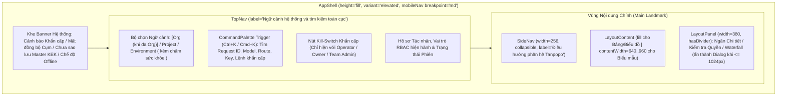

# Kiến trúc Thông tin & Nhất quán Ngôn ngữ Thiết kế (Information Architecture & Terminology Governance) — Tanpopo

> **Tài liệu Thiết kế Trải nghiệm Sản phẩm (Phase ASTRA A06 — `DRAFT / READY_FOR_REVIEW`)**
> - **Mã tài liệu:** `SPEC-UX-01` | **Phiên bản:** `0.1.0-step06-draft` | **Ngày cập nhật:** `2026-11-11`
> - **Vai trò biên soạn:** Lead Product Designer & Developer Experience Lead
> - **Trạng thái quản trị:** **Đặc tả Thiết kế Đề xuất (`PROPOSED — NO CODE`)** — bám sát [`prd.md`](../product/prd.md), [`srs.md`](../requirements/srs.md), [`workflows.md`](../requirements/workflows.md), [`system-design.md`](../architecture/system-design.md) và [`ADR-0004`](../architecture/adr/0004-web-console-stack-astryx-evaluation-and-repo-layout.md). Không lập trình giao diện và không khóa cứng gói cảm quan ngoài `neutral` mặc định khi Product Owner chưa duyệt.
> - **Truy vết Yêu cầu:** `TP-FR-0201`..`0504`, `TP-FR-0902`, `TP-NFR-0701`, `TP-NFR-0702`, `TP-NFR-1001`, `TP-NFR-1002`, `DEC-003`, `DEC-004`, `BA-OQ-001`.

---

## 1. Triết lý Tổ chức Không gian Quản trị (IA Principles)

Tanpopo Web Console phục vụ đồng thời hai thái cực người dùng (`SD-G1-01`): một **Solo Developer / Nhóm nhỏ** cần gửi yêu cầu thành công đầu tiên trong dưới `3 phút` (`TTFGR < 180s`), và một **Đội ngũ AI Platform / Bảo mật** cần kiểm soát chặt hàng chục kết nối, ngân sách `micro-USD`, cổng MCP và phần mở rộng bên thứ ba mà không nhầm lẫn khái niệm.

Bốn nguyên tắc bất biến chi phối toàn bộ Kiến trúc Thông tin (`IA`):
1. **Không trộn lẫn 4 lớp kiến trúc (`DEC-003`):** `Extension Package (Plugin)`, `Provider / Model`, `MCP Governance` và `A2A Agents` có nhánh điều hướng, biểu tượng và danh từ riêng biệt — tuyệt đối không gom chung vào một mục "Integrations" mơ hồ.
2. **Ngữ cảnh Phân cấp Tường minh nhưng Tinh gọn Ngày đầu (`BA-OQ-001`):** Mọi màn hình dữ liệu đều neo rõ vào ngữ cảnh `Organization → Project → Environment`. Ở chế độ mặc định `0.x` (1 `Organization` duy nhất), bộ chọn ẩn bớt tầng `Organization` thừa để giảm nhiễu nhận thức, chỉ hiển thị `Project / Environment` trên thanh `TopNav`.
3. **Minh bạch Rủi ro Trước Hành động (`No Hidden Community Risk`):** Không bao giờ đặt nút cài đặt một chạm làm khuất danh tính nhà phát hành (`Publisher`), nguồn gốc gói (`Origin`) hay danh mục quyền mạng/bí mật (`Permission Inspection Sheet`).
4. **Hành động Khẩn cấp Luôn Trong Tầm Tay (`<= 3 Tương tác`):** Công tắc khẩn cấp 4 cấp (`Kill-Switch`: thu hồi khóa ảo, đóng băng dự án, ngắt kết nối, cách ly plugin) luôn truy cập được ngay từ thanh `TopNav` hoặc hộp lệnh nhanh `CommandPalette` (`Ctrl+K` / `Cmd+K`) trên cả máy tính lẫn điện thoại (`375px`).

---

## 2. Khung Điều hướng Toàn cục (`Global Shell & Context Frame`)

Theo hướng dẫn `layout/scaffold` của Astryx Design System, Tanpopo thuộc nhóm **Suite Console** nên sử dụng khung [`AppShell`](design-system-integration.md) kết hợp cả hai trục có phân vai rạch ròi:

- **Quy tắc phân vai `TopNav` vs `SideNav`:** `TopNav` **chỉ** mang ngữ cảnh bao trùm (`Project / Environment`), thanh tìm kiếm lệnh `CommandPalette`, chuông phê duyệt/cảnh báo và hồ sơ người dùng. `SideNav` mang toàn bộ cây tính năng sản phẩm chia thành **5 nhóm chức năng cố định**; con số đếm trên mục điều hướng dùng `Badge` **chỉ cho số lượng mục đang chờ xử lý** (ví dụ: `3` yêu cầu phê duyệt công cụ `destructive`, `1` plugin chờ duyệt lại quyền khi cập nhật).

---

## 3. Sơ đồ Cây Kiến trúc Thông tin & Bản đồ Định tuyến URL (11 Phân khu Bắt buộc)

Bảng dưới đây quy hoạch đầy đủ **11 phân khu bắt buộc** của Tanpopo, gắn rõ đường dẫn URL, phạm vi ngữ cảnh (`Instance-Wide` toàn máy chủ vs `Environment-Scoped` theo môi trường) và nhịp phát hành dự kiến (`SD-G1-03` — tránh hiển thị tính năng rỗng gây hiểu lầm là lỗi):

| Nhóm SideNav | Phân khu IA (11 Miền) | Đường dẫn URL Chuẩn | Phạm vi Dữ liệu | Nhịp dự kiến (`PROPOSED`) | Mã Màn hình (`SPEC-UX-03`) |
|---|---|---|---|---|---|
| *(Ngoài Shell chính)* | **1. Onboarding & Setup** | `/setup` `/login` | Toàn máy chủ (`Instance`) | `v0.1` (`Must`) | `SCR-01` |
| **A. Tổng quan & Quan sát** | **2. Overview (Bảng điều khiển chính)** | `/overview` | Theo `Project / Env` (hoặc Toàn cục cho `Operator`) | `v0.1` (`Must`) | `SCR-02` |
| **A. Tổng quan & Quan sát** | **8. Observability & FinOps** | `/observability/traces` `/finops/budgets` `/finops/chargeback` | Theo `Org / Project / Env` | `v0.1` (`Must` — cơ bản) `v0.2` (`Should` — Chargeback đầy đủ) | `SCR-11` `SCR-12` |
| **B. Cổng Mô hình & Định tuyến** | **3. Providers, Connections & Models** | `/providers/adapters` `/providers/connections` `/models` | `Adapters`: Toàn máy chủ `Connections`: `Org` hoặc `Project` `Models / Deployments`: `Env` | `v0.1` (`Must`) *(OAuth 2.1 ở `v0.2`)* | `SCR-03` `SCR-04` `SCR-05` |
| **B. Cổng Mô hình & Định tuyến** | **6. Routes & Policies** | `/routes` `/routes/explain` `/policies` | Kế thừa phân cấp `Org → Project → Env` | `v0.1` (`Must` — Route/Policy) `v0.2` (`Should` — `Route Explain`) | `SCR-08` `SCR-09` |
| **C. Hệ sinh thái & Tác nhân** | **4. Extension Marketplace & Installed Plugins** | `/extensions/marketplace` `/extensions/installed` `/extensions/lockfile` | Cài đặt cấp `Instance`, bật/tắt cấp `Org / Project` | `v0.1` (`Must` — Git/URL/Gói) `v0.2` (`Should` — Chợ & Kho riêng) | `SCR-06` `SCR-07` |
| **C. Hệ sinh thái & Tác nhân** | **5. MCP Tools & A2A Agents** | `/mcp/servers` & `/mcp/tools` `/a2a/agents` & `/a2a/tasks` | Theo `Project / Env` | `MCP`: `v0.2` (`Should`) `A2A`: `v0.3` (`Could`) | `SCR-10` |
| **D. Truy cập & Bảo mật** | **7. API Keys, Users & Teams** | `/access/virtual-keys` `/access/members` `/access/roles` | `Keys`: Gắn cứng 1 `Env` `Members/Roles`: `Org / Project` | `v0.1` (`Must`) *(SSO OIDC ở `v0.3`)* | `SCR-13` |
| **D. Truy cập & Bảo mật** | **9. Security, Approvals & Kill-Switches** | `/security/approvals` `/security/audit-log` `/security/kill-switches` | Theo `Org / Project` (Riêng `Quarantine` là `Instance`) | `v0.1` (`Must` — Audit & Kill-Switch) `v0.2` (`Should` — MCP Approvals) | `SCR-14` |
| **E. Công cụ & Hệ thống** | **11. Developer Tools** | `/devtools/playground` `/devtools/api-explorer` `/devtools/sdk-snippets` `/devtools/diagnostics` | Theo `Env` đang chọn | `v0.1` (`Must` — Snippets/Smoke Test) `v0.2` (`Should` — Playground) | `SCR-15` |
| **E. Công cụ & Hệ thống** | **10. Operations & Settings** | `/ops/health` `/ops/backups` `/ops/upgrades` `/settings/residency-retention` | `Ops`: Toàn máy chủ (`OPERATOR`) `Residency/Retention`: `Org` | `v0.1` (`Must`) | `SCR-16` |

> **Quy tắc Hiển thị Tính năng Phân kỳ (`Phased IA Rule`):** Ở bản `v0.1`, các mục chưa phát hành như `MCP Hub (v0.2)` hoặc `A2A Agents (v0.3)` **không được hiển thị như màn hình trống bị hỏng**; chúng phải được ẩn mặc định khỏi `SideNav` sản xuất (hoặc gắn thẻ `Token` ghi rõ `Roadmap v0.2 / v0.3` trong khu vực giới thiệu kiến trúc nếu người vận hành bật chế độ xem trước lộ trình).

---

## 4. Ma trận Phân quyền Hiển thị Điều hướng theo Vai trò (`RBAC Visibility Matrix`)

| Phân khu IA | `Personal Admin` *(Đơn người dùng)* | `OPERATOR` *(Hạ tầng)* | `ORG_OWNER` *(Chủ tổ chức)* | `TEAM_ADMIN` *(Quản trị dự án)* | `REVIEWER` *(Thẩm định độc lập)* | `DEVELOPER` *(Kỹ sư tích hợp)* |
|---|---|---|---|---|---|---|
| **1. Onboarding (`/setup`)** | Toàn quyền (lần đầu) | Toàn quyền (lần đầu) | Không | Không | Không | Không |
| **2. Overview (`/overview`)** | Toàn cục | Sức khỏe cụm & hạ tầng | Toàn `Organization` | Trong `Project` mình | Chỉ đọc trong phạm vi | Chỉ đọc `Project/Env` được cấp |
| **3. Providers / Connections / Models** | Toàn quyền | Xem Adapter; không xem khóa riêng `Org` | Toàn quyền `Connections` cấp `Org` | Tạo `Connection` riêng của `Project` | Chỉ đọc cấu hình | Chỉ đọc danh mục `Models` được phép gọi |
| **4. Marketplace / Installed Plugins** | Toàn quyền | Cài/Nâng cấp/Cách ly cấp máy chủ | Bật/Tắt cho `Org`; đề xuất cài | Xem danh sách đã bật | **Phê duyệt Quyền (`Four-Eyes`)** | Chỉ đọc các Adapter đang mở |
| **5. MCP Tools & A2A Agents** | Toàn quyền | Xem trạng thái kết nối | Toàn quyền chính sách `Org` | Đăng ký MCP/Agent cấp `Project` | **Duyệt lệnh `destructive` (`SM-06`)** | Xem danh mục Tool mà khóa mình được gọi |
| **6. Routes & Policies** | Toàn quyền | Chính sách nền cấp máy chủ | Chính sách trần cấp `Org` | Tạo `Route` & thu hẹp `Policy` dự án | Chỉ đọc & Chạy `Route Explain` | Chạy `Route Explain` thử nghiệm |
| **7. Virtual Keys, Users & Teams** | Toàn quyền | Quản lý quản trị viên máy chủ | Quản lý thành viên, vai trò & khóa | Cấp/Xoay/Thu hồi khóa trong `Project` | Chỉ đọc danh mục khóa | Tạo/Xoay khóa cá nhân (nếu `Policy` cho phép) |
| **8. Observability & FinOps** | Toàn quyền | Số đo kỹ thuật OTel & tài nguyên | Toàn bộ Sổ cái, Ngân sách & `Chargeback` | Ngân sách & Truy vết của `Project` | Đọc phục vụ kiểm tra | Chỉ xem truy vết & chi phí của khóa mình |
| **9. Security, Approvals & Kill-Switches** | Toàn quyền | `Quarantine` Plugin; đọc Audit hạ tầng | Đọc toàn bộ Audit `Org`; Kill-Switch `Org` | Kill-Switch `Key`/`Project` mình | **Hàng đợi Phê duyệt & Đọc Audit** | Xem trạng thái yêu cầu chờ duyệt của mình |
| **10. Operations & Settings** | Toàn quyền | **Toàn quyền** (Sao lưu, Nâng cấp, Cụm) | Cấu hình `Data Residency` & `TTL` của `Org` | Xem vùng cư trú áp dụng cho dự án | Chỉ đọc chính sách lưu giữ | Không hiển thị mục `Ops` hạ tầng |
| **11. Developer Tools** | Toàn quyền | Công cụ chẩn đoán `support-bundle` | Toàn quyền | Toàn quyền trong `Project` | Chỉ dùng `Route Explain` | **Không gian làm việc chính** (`Playground`, SDK) |

---

## 5. Chuẩn Nhất quán Thuật ngữ & Chống Đánh đồng Rủi ro (`Design & Terminology Consistency`)

Mọi nhãn giao diện, thông báo lỗi, tài liệu hướng dẫn và lệnh CLI **bắt buộc** dùng thống nhất bảng thuật ngữ dưới đây (nghiêm cấm dùng lẫn lộn từ "Provider" để chỉ cả gói phần mềm, tài khoản xác thực lẫn mô hình):

| Khái niệm Chuẩn trên UI & CLI | Định nghĩa hiển thị ngắn gọn trên Giao diện | Ví dụ Minh họa trên Màn hình | Những gì TUYỆT ĐỐI KHÔNG ĐƯỢC GỌI NHẦM |
|---|---|---|---|
| **`Extension Package` (`Plugin`)** | Gói phần mềm mở rộng có phiên bản & chữ ký số cài vào Tanpopo từ Marketplace, Git, URL hoặc kho OCI. | `tanpopo-adapter-mistral@1.2.0` (`Tier 1: Declarative`) | Không gọi là "Provider" hay "Connection" (1 gói `Extension` có thể chứa cả `Adapter` lẫn `Guardrail`). |
| **`Provider Adapter`** | Trình điều khiển giao thức giúp Tanpopo biết cách nói chuyện với một dòng dịch vụ AI hoặc máy chủ mô hình. | `OpenAI Official Adapter`, `Ollama Local Adapter` | Không chứa API Key hay hóa đơn; chỉ là bộ dịch giao thức. |
| **`Provider Connection`** | Hồ sơ thông tin xác thực cụ thể (API Key, `Authorized OAuth`, AWS IAM...) nối một `Adapter` tới tài khoản thật. | `prod-openai-eu-key-01` (`ACTIVE`, vùng `EU`) | Không gọi chung là "Plugin"; một `Adapter` có thể có `10` `Provider Connections` của các phòng ban khác nhau. |
| **`Logical Model`** | Định danh năng lực mô hình chuẩn hóa mà ứng dụng gọi tới qua API hoặc gắn vào `Route`. | `claude-sonnet-4`, `llama-3.3-70b` | Không gắn cứng với một khóa API đơn lẻ. |
| **`Model Deployment`** | Đích thực thi vật lý ghép `Logical Model` + `Provider Connection` + `Data Region` + bảng giá `micro-USD`. | `claude-sonnet-4 via prod-vertex-eu (Region: EU)` | Đây mới là phần tử mà Bộ định tuyến kiểm tra sức khỏe (`SM-04`) và tính tiền. |
| **`MCP Server` & `MCP Tool`** | Máy chủ ngữ cảnh công cụ ngoài chuẩn MCP và từng hàm thao tác cụ thể (được đóng dấu `schema_hash` & mức rủi ro). | Server `github-enterprise-mcp` → Tool `delete_repo` (`destructive`) | Không bao giờ hiển thị chung bảng với `Provider Adapter` hay `LLM Model`. |
| **`A2A Agent`** | Tác nhân tự chủ đăng ký hồ sơ `AgentCard` nhận ủy quyền tác vụ bất đồng bộ có trần ngân sách và độ sâu ủy quyền. | `sec-triage-agent` (`max_hops: 3`) | Không gộp làm một với hàm công cụ đơn lẻ `MCP Tool`. |

### Quy tắc Hiển thị Ba Chiều Tin cậy Trước Mọi Thao tác Cài đặt / Cập nhật (`No One-Click Blind Install`)

Trên mọi danh sách trong `Extension Marketplace` và màn hình `Install from Git / URL / Archive`, hệ thống **cấm hiển thị một nút `Install` duy nhất kích hoạt ngầm**, mà bắt buộc trình bày đủ **3 thẻ `Token` độc lập (kèm biểu tượng riêng biệt)** ngay trên thẻ gói và lặp lại trong hộp kiểm tra `Permission Inspection Sheet`:
1. **Nguồn cài đặt (`Origin`):** `Curated Marketplace` | `Git Repository (Pinned SHA)` | `Direct Archive (.tpkg)` | `Private OCI Registry`.
2. **Độ tin cậy Nhà phát hành (`Publisher Trust Tier`):**
   - `Official` (biểu tượng khiên xác thực — do dự án Tanpopo duy trì & ký số, tuân thủ API chính thức `DEC-004`),
   - `Verified Publisher` (biểu tượng dấu kiểm đã xác minh danh tính DNS/OIDC & vượt qua bộ kiểm thử hợp đồng `CT-01`..`24`),
   - `Private Enterprise` (ký bằng khóa nội bộ của chính tổ chức tự vận hành),
   - `Unverified External` (biểu tượng cảnh báo tam giác — gói bên thứ ba chưa qua thẩm định của Tanpopo; bắt buộc quản trị viên tích xác nhận hiểu rõ phạm vi quyền trước khi bật).
3. **Tầng Cô lập Thực thi (`Execution Tier`):** `Tier 1: Declarative (Zero Code)` | `Tier 2: Wasm Sandbox` | `Tier 3: Isolated Sidecar`.
