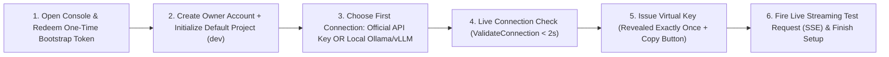
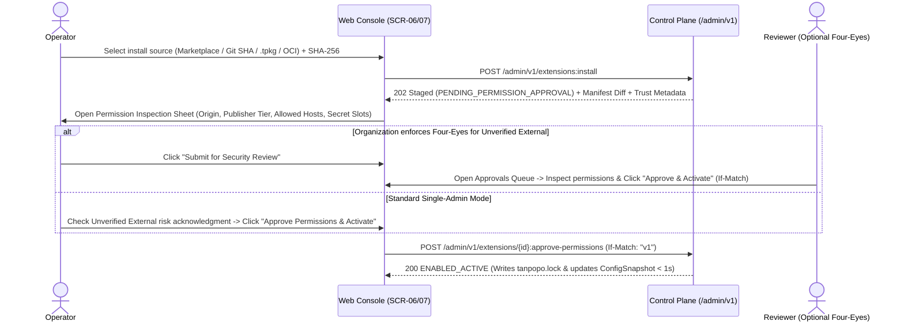
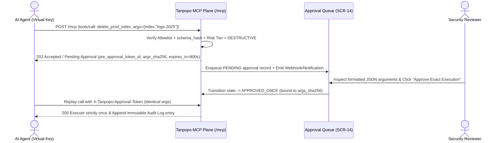

# End-to-End User Flows & Five-State UI Matrices — Tanpopo

> **Interaction Flow Specification (Phase ASTRA A06 — `DRAFT / READY_FOR_REVIEW`)**
> - **Document ID:** `SPEC-UX-02` | **Version:** `0.1.0-step06-draft` | **Last Updated:** `2026-11-11`
> - **Authored By:** Lead Product Designer & Developer Experience Lead
> - **Governance Status:** **Proposed Design Specification (`PROPOSED — NO CODE`)** — operationalizes the 13 business workflows in [`workflows.md`](../requirements/workflows.md) into **8 core end-to-end user journeys across Web Console & CLI**, complete with all **5 mandatory UI states (`Happy`, `Loading`, `Empty`, `Error`, `Offline`)** per journey.
> - **Requirements Traceability:** `WF-01`..`WF-12`, `SM-01`..`SM-08`, `TP-FR-0101`..`1004`, `TP-NFR-0404`, `TP-NFR-0701`, `TP-NFR-1001`.

---

## Overview of the 8 Core User Journeys (`UJ-01` .. `UJ-08`)

Every user journey below strictly enforces the discipline of `frontend-ui-engineering`: **no workflow is specified solely as a Happy Path**. Each journey explicitly defines UI rendering and system feedback during asynchronous or streaming execution (`Loading`), zero-data initial or filtered states (`Empty`), contract/validation/concurrency failures (`Error`), and browser disconnection or isolated intranet operation (`Offline / Air-Gapped`).

---

## `UJ-01`: Zero-to-First-Successful-Request (`TTFGR < 3 Minutes` — `WF-01`, `WF-02`)

- **Actor:** `Personal Admin` or `OPERATOR` booting Tanpopo for the first time.
- **Objective:** Progress from an unconfigured fresh `tanpopod` process to the first successful inference request through the Unified API in **under `180 seconds`** without consulting multi-page external setup guides.

| UI State | Concrete Interface Behavior & System Feedback |
|---|---|
| **`Happy`** | Step 1 verifies the `Bootstrap Token` (printed to `tanpopod` startup logs) and permanently invalidates it immediately upon creating the administrator password. Step 3 offers 2 clear fast paths: (a) paste an official commercial API Key (OpenAI/Anthropic/Gemini, etc.) or (b) auto-detect a local `Ollama`/`vLLM` model server. Step 5 opens a modal dialog revealing `vk_tp_live_...` **strictly once** alongside pre-populated `curl` / Python SDK snippets so the user can click **`"Send Test Request"`** inline, receiving live SSE token chunks plus settled `micro-USD` cost and `request_id`. |
| **`Loading`** | The `Vertical Wizard` frame (`form-wizard-vertical`) keeps the left-hand progress rail stable; clicking **`"Verify & Connect"`** enters `isLoading` state while broadcasting a screen-reader status update via `useAnnounce('Verifying upstream provider connection...')`; the inline test step streams incremental token deltas in real time. |
| **`Empty`** | Prior to connecting a provider at Step 3, the model preview area renders an actionable empty state: *"No models ready yet. Connect an official commercial API key or point to a local Ollama/vLLM server to unlock your first request."* (Includes a secondary skip link to enter the Console directly and configure later). |
| **`Error`** | - Invalid or expired `Bootstrap Token` (`> 15 minutes`): renders a clear error banner quoting the exact CLI command `tanpopo admin reset-bootstrap-token` to mint a fresh token. - Upstream API key rejected (`401` from vendor): preserves the typed connection name, clears the write-only secret input for re-entry, and displays the normalized error code without echoing raw secret text. |
| **`Offline`** | When `tanpopod` runs inside an isolated intranet without public Internet egress (`Air-Gapped`), the wizard detects cloud catalog unreachability immediately, surfaces a calm informational `Banner` (*"Running in Local Network / Offline Mode"*), and promotes **Local Model (`Ollama` / `vLLM` / `OpenAI-Compatible LAN Endpoint`)** to the primary selection slot without hanging on external timeouts. |

---

## `UJ-02`: External Provider Plugin Installation & Explicit Permission Inspection (`WF-04`, `SM-01`)

- **Actor:** `OPERATOR` (stages installation) + `REVIEWER` (when organizational `Four-Eyes` governance is enabled).
- **Objective:** Install an external `Provider Adapter` package (from Marketplace, pinned Git commit SHA, `.tpkg` archive, or internal OCI registry) **without recompiling Tanpopo Core**, while mandating full inspection of publisher identity, trust tier, and requested permissions prior to activation.

| UI State | Concrete Interface Behavior & System Feedback |
|---|---|
| **`Happy`** | The package is downloaded into an isolated staging area, verified against its `SHA-256` digest and signature, and presented inside the mandatory **`Permission Inspection Sheet`** displaying: (1) 3 independent `Token` badges (`Origin`, `Publisher Trust Tier`, `Execution Tier`), (2) exact outbound domains permitted (`network.allowed_hosts`), (3) named secret slots injected via the `Blind Broker`, and (4) CPU/memory sandbox ceilings. Upon approval, the extension transitions to `ENABLED_ACTIVE` hot without restarting Core. |
| **`Loading`** | Displays granular verification milestones: `Downloading bundle` → `Verifying SHA-256 & Cosign signature` → `Validating contract compatibility` → `Extracting permission manifest`. |
| **`Empty`** | When `Installed Plugins` contains only bundled default drivers, the view cleanly separates *"Built-in Official Adapters"* from an actionable callout guiding operators to *"Install additional Providers or Guardrails from Marketplace, Git, or `.tpkg` archives"*. |
| **`Error`** | - `SHA-256` digest mismatch or incompatible `contract_version`: halts immediately with an error dialog comparing the running Core version against the manifest's required contract range. - Manifest requests forbidden wildcard network egress (`*`) or attempts to spoof `@tanpopo-official/*` without an official signature: hard-rejects installation and records a security event in `Audit Log`. - `409 version_conflict` from concurrent administrator approval: reloads latest server state rather than blindly overwriting. |
| **`Offline`** | When the public Marketplace index is unreachable, the `Curated Marketplace` tab displays the cached snapshot stamped with *"Offline catalog last synced: ..."* and prominently foregrounds the 2 fully air-gapped installation paths: **Upload signed `.tpkg` archive (`tanpopo bundle import`)** or **Pull from internal Private OCI Registry**. |

---

## `UJ-03`: Legitimate `Authorized OAuth 2.1` Grant & Expiry Re-Authentication (`WF-05`, `SM-02`, `SM-03`)

- **Actor:** `ORG_OWNER` or `TEAM_ADMIN`.
- **Objective:** Establish a `Provider Connection` via `OAuth 2.1 Authorization Code + PKCE (S256)` or `Device Authorization Flow` for platforms that officially sanction programmatic OAuth gateways (e.g., Google Cloud Vertex AI or enterprise internal AI SSO gateways), strictly forbidding browser session cookie pasting or repurposing consumer subscriptions into shared API proxies (`DEC-004`).

| UI State | Concrete Interface Behavior & System Feedback |
|---|---|
| **`Happy`** | The administrator selects a `Provider Adapter` declaring `auth_methods: ["oauth2_pkce"]`, picks least-privilege `scopes`, and clicks **`"Authorize with Provider"`**. The Control Plane mints a CSRF `state` nonce + PKCE `code_verifier` and redirects to the vendor's official authorization server. Upon returning to `/admin/v1/oauth/callback`, Tanpopo seals the `access_token`/`refresh_token` pair directly into the write-only vault, returning to the browser only `ACTIVE` posture, principal identifier (e.g., `gcp-sa@corp.iam`), granted `scopes`, and token expiry metadata. |
| **`Loading`** | While awaiting OAuth callback or polling during `Device Code Flow` on a headless server, the UI renders the short verification code with a live expiry countdown and an always-enabled **`"Cancel Authorization"`** button. |
| **`Empty`** | If the selected `Adapter` **does not support** sanctioned OAuth (e.g., the vendor authorizes gateway access solely via pay-per-use Commercial API Keys), OAuth controls remain **completely hidden or disabled with an honest explanation**: *"This provider authorizes gateway access exclusively via Commercial API Keys; OAuth proxy flows are not supported."* |
| **`Error`** | - User denial (`access_denied`), CSRF `state` mismatch, or missing mandatory `scope` in the returned token: aborts the draft connection cleanly with zero partial secret persistence. - Upstream revocation of `refresh_token` during production operation (`SM-03` transitions to `AUTH_EXPIRED_REAUTH_REQUIRED`): surfaces an orange warning `Banner` with a one-click **`"Re-authorize Connection"`** button while multi-target routes automatically fail over traffic to healthy backup deployments. |
| **`Offline`** | If the administrator's browser has Internet access while `tanpopod` runs inside a restricted subnet unable to reach the vendor's `token_endpoint`, preflight connectivity validation reports `Egress unreachable to token_endpoint` immediately before opening a doomed login redirect. |

---

## `UJ-04`: Model Catalog Discovery & Capability Assurance Comparison (`FT-03`, `SPEC-EXT-02`)

- **Actor:** `DEVELOPER`, `TEAM_ADMIN`.
- **Objective:** Quickly discover which `Logical Models` and `Model Deployments` are available in the active `Environment`, filtering accurately by capability (`vision`, `tools`, `strict_json_schema`, `reasoning`), data residency (`EU`, `US`, `ON_PREM`), `micro-USD` pricing, and empirical assurance tier.

| UI State | Concrete Interface Behavior & System Feedback |
|---|---|
| **`Happy`** | `/models` (scaffolded from `table-filter`) renders dense tabular rows (`Table`) showing `Model Slug`, healthy `Deployment` count, capability tags, assurance level (`Token` with distinct icons for `VERIFIED` / `TESTED` / `DECLARED`), data regions, and input/output rates per `1M tokens`. Selecting a row opens `LayoutPanel` comparing parameters supported across the **Unified API** versus vendor-specific features requiring **Native Passthrough** (`/native/...`) or marked **Unsupported**. |
| **`Loading`** | Preserves table column headers and filter controls intact while rendering `Table skeleton rows` with zero layout shift (`CLS = 0`). |
| **`Empty`** | - Zero models bound in the `Environment`: guides `TEAM_ADMIN` to attach a `Model Deployment` from an active `Provider Connection`. - Over-constrained filter combination (e.g., `ON_PREM` + `audio_input` yielding 0 matches): displays **`"Clear active filters"`** and highlights which filter facet eliminated remaining candidates. |
| **`Error`** | Whenever a `Model Deployment` enters `CIRCUIT_OPEN` or `DEGRADED`, its row surfaces the latest upstream failure reason inline (e.g., `Upstream 429 Rate Limit — half-open probe in 24s`) so engineers never discover outages blindly in production. |
| **`Offline`** | Operates `100%` from the self-hosted instance's in-memory `ConfigSnapshot` without fetching pricing tables or model catalogs from any external cloud service. |

---

## `UJ-05`: Capability-Aware Route Creation & `Route Explain` Simulation (`WF-07`, `SPEC-CORE-01`)

- **Actor:** `TEAM_ADMIN`, `ORG_OWNER`, `DEVELOPER` (dry-run simulation).
- **Objective:** Author a `Route` (e.g., `prod-assistant-default`) composing multiple fallback `Model Deployments` under a routing strategy (`Priority`, `Weighted`, `Lowest-Cost`), enforce `Fail-Closed` data residency, and dry-run routing decisions (`Dry-Run Route Explain`) before exposing live traffic.

| UI State | Concrete Interface Behavior & System Feedback |
|---|---|
| **`Happy`** | Two-column workspace (`form-two-column`): the left column configures route slug, minimum required capabilities, data residency constraints (e.g., `EU Only — Fail Closed`), and ordered `Deployments`; the right column hosts a sticky **Live `Route Explain` Simulator** accepting synthetic request traits (e.g., `has_vision: true, tools: true, region: EU`) and rendering the exact candidate decision tree showing why Target #1 won and why Target #2 was eliminated (e.g., *"Eliminated: Region US violates EU residency policy"*). Saving with `If-Match` propagates to the hot router in `< 1s`. |
| **`Loading`** | Invoking `POST /admin/v1/routes:explain` renders a brief computation indicator (`< 50 ms`, `0` outbound provider network calls). |
| **`Empty`** | When authoring a brand-new route prior to selecting targets, the candidate picker automatically suggests `Model Deployments` in the active `Environment` matching the project's residency posture. |
| **`Error`** | - Immediate configuration-time warning if every `Deployment` added to the route violates an inherited `Organization Policy` residency lock (which would deterministically fail at runtime with `503 no_compliant_deployment_available`). - Hard-locks mid-stream failover (`Fallback after partial stream` remains permanently disabled per `TP-BR-0503` with an explanatory tooltip detailing corrupted-stream prevention). |
| **`Offline`** | Both the route builder and dry-run `Route Explain` engine execute purely against in-memory Control Plane metadata with zero external network dependency. |

---

## `UJ-06`: Per-Virtual-Key MCP Tool Scoping & Human-in-the-Loop Approval for `destructive` Calls (`WF-09`, `SM-06`)

- **Actor:** `TEAM_ADMIN` (scopes tools), `API Client / Agent` (invokes tool), `REVIEWER` (approves sensitive execution).
- **Objective:** Ensure each `Virtual Key` sees and invokes strictly its allowlisted subset of `schema_hash`-pinned `MCP Tools`, while intercepting every `destructive` tool invocation until a human reviewer approves the exact SHA-256-hashed parameter payload (`BA-OQ-004`).

| UI State | Concrete Interface Behavior & System Feedback |
|---|---|
| **`Happy`** | On the `Virtual Key` form, administrators select individual `MCP Tools` granularly (rather than granting blanket server access). When a `destructive` call arrives, `Security & Approvals` on `SideNav` increments its `Badge` count; `REVIEWER` opens the inspection drawer displaying caller identity, target tool, upstream server, formatted JSON arguments, and expiry countdown. Once approved, the single-use token authorizes **strictly 1 execution** with **that exact parameter hash**. |
| **`Loading`** | The approval queue streams live state updates; clicking approve immediately locks the action button to prevent double-submission. |
| **`Empty`** | With zero pending approvals, the queue renders a calm zero-inbox posture: *"No sensitive tool executions awaiting approval"* with a link to review historical decisions in `Audit Log`. |
| **`Error`** | - Upstream MCP server silently alters a tool's description or input schema (*Tool Poisoning / Rug-Pull*): Tanpopo automatically blocks calls (`403 schema_hash_drift_blocked`) and flags `/mcp/tools` with a red drift alert requiring administrator review of the old-vs-new schema `diff` before re-pinning. - Agent replays an approved token while mutating even 1 character of arguments: hard-rejected with `403 parameter_hash_mismatch`. - Mutating/destructive tool execution times out upstream: marked `AMBIGUOUS_TIMEOUT` (never retried automatically per `TP-BR-0603`). |
| **`Offline`** | If the `REVIEWER`'s browser loses connectivity to the Control Plane mid-click, the UI surfaces connection loss immediately, **never renders a fake optimistic approval**, and requires re-fetching authoritative server state upon reconnection. |

---

## `UJ-07`: Plugin Upgrade, Permission-Escalation Blocking & Emergency Rollback (`WF-11`, `SM-01`, `SM-08`)

- **Actor:** `OPERATOR` (plus `REVIEWER` when permissions expand).
- **Objective:** Upgrade a live `Extension` without dropping active inference streams, **block silent permission expansion on upgrade (`Permission Escalation`)**, and support `< 5 second` rollback to the previously pinned version.

| UI State | Concrete Interface Behavior & System Feedback |
|---|---|
| **`Happy`** | - **Non-escalating upgrade (identical or narrower permissions):** Stages the new archive, runs automated contract checks, updates `tanpopo.lock` (retaining the prior artifact in local cache for instant rollback), and atomically flips `ConfigSnapshot` while allowing in-flight streams on the old version to drain naturally. - **Rollback:** Clicking **`"Rollback to Previous Pin (`v1.1.0`)"`** → confirming inside `AlertDialog` → restores the prior version across active nodes in `< 5 seconds`. |
| **`Loading`** | Displays explicit transition phases inline on the plugin row: `Validating v1.2.0` → `Draining active streams on v1.1.0 (12 remaining)` → `Active on v1.2.0`. |
| **`Empty`** | If an extension sits on its initial installation pin with zero prior upgrade history, the `Rollback` button is disabled with an explanatory tooltip: *"No previous pinned version exists; use Disable or Quarantine for emergency cutoff."* |
| **`Error`** | **Permission Escalation Intercepted (`TP-BR-0403`):** Whenever `v1.2.0` requests an additional outbound domain (e.g., `telemetry.thirdparty.io`) or a new secret slot beyond `v1.1.0`, Tanpopo **refuses automatic activation**, parks the upgrade in `UPDATING_PENDING_RECONSENT`, keeps `v1.1.0` serving production safely, and prompts the administrator to inspect the **Side-by-Side Permission Diff** dialog to explicitly re-consent or abort the upgrade. |
| **`Offline`** | Inside air-gapped environments, upgrades resolve directly against pre-imported local bundles (`tanpopo bundle import`) and verify against `tanpopo.lock` with zero Internet calls. |

---

## `UJ-08`: Tracing & Diagnosing Failed / Slow / Blocked Requests (`WF-06`, `OPS-07`, `SPEC-CORE-02`)

- **Actor:** `DEVELOPER`, `TEAM_ADMIN`, `OPERATOR`.
- **Objective:** Whenever a client receives an error (`400`, `403`, `429`, `502`, `503`, or `mid_stream_abort`) carrying a `request_id`, pasting that `request_id` into the Console pinpoints the exact stage among the 12 hot-path steps where execution stopped and surfaces immediate remediation without exposing secrets or private prompt payloads.

| UI State | Concrete Interface Behavior & System Feedback |
|---|---|
| **`Happy`** | Pressing `Ctrl+K` and pasting `req_01j...` opens the **Request Waterfall Inspector** on `/observability/traces`, rendering per-stage millisecond spans (`Auth` `0.2ms` → `Budget Hold` `0.6ms` → `Policy` `0.3ms` → `Route Match` → `Attempt #1 Upstream 429` → `Pre-Stream Failover Attempt #2` → `TTFT` → `Budget Settlement`), cost accuracy (`EXACT` / `ESTIMATED`), normalized `CanonicalError` code, concrete remediation steps, and **`"Simulate in Route Explain"`** to replay routing metadata safely. |
| **`Loading`** | If a request finished a few hundred milliseconds ago and `AsyncTraceFlusher` is still committing the batch to storage, the UI displays *"Syncing newly completed trace record (auto-retrying in 1s)..."* rather than flashing a premature not-found error. |
| **`Empty`** | In a newly created environment with zero recorded traffic, the traces view offers quickstart actions to open `Playground` or copy an SDK snippet to send a first request. |
| **`Error`** | - If a `DEVELOPER` pastes a `request_id` belonging to another `Project` or `Organization` outside their RBAC scope: returns a uniform `"Trace ID not found within authorized scope"` message (`TP-BR-0101` — preventing cross-tenant enumeration). - Visually distinguishes **Successful Pre-Stream Failover** from **Mid-Stream Abort (`mid_stream_abort`)**, explaining why Tanpopo never splices output from a second upstream model once initial stream chunks have been emitted to the client. |
| **`Offline`** | Queries local SQLite / PostgreSQL storage directly on the self-hosted instance; even if an external OTel collector (Grafana/Datadog) is unreachable, operators retain full visibility into locally persisted metadata traces alongside a `Banner` indicating OTLP export buffering. |
