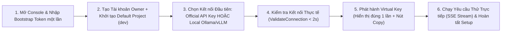
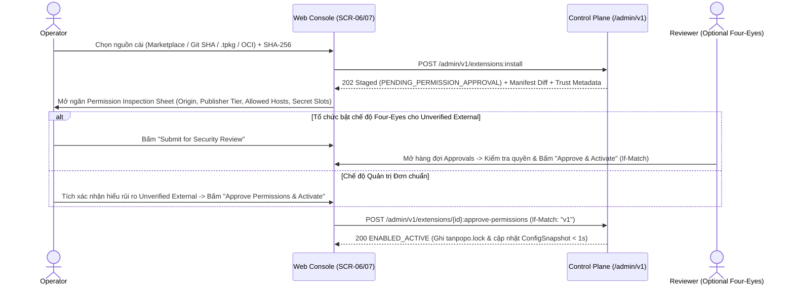
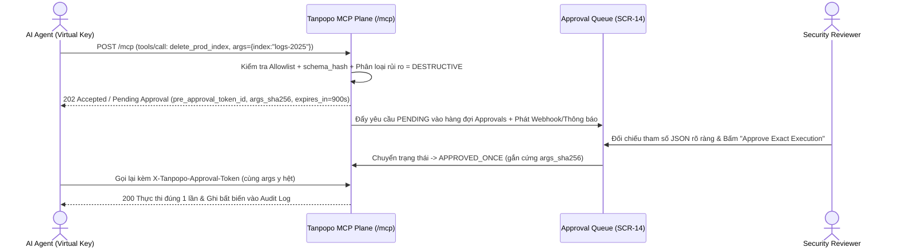

# Hành trình Người dùng Đầu-Cuối & Ma trận 5 Trạng thái Giao diện (End-to-End User Flows & State Matrices) — Tanpopo

> **Tài liệu Thiết kế Luồng Tương tác (Phase ASTRA A06 — `DRAFT / READY_FOR_REVIEW`)**
> - **Mã tài liệu:** `SPEC-UX-02` | **Phiên bản:** `0.1.0-step06-draft` | **Ngày cập nhật:** `2026-11-11`
> - **Vai trò biên soạn:** Lead Product Designer & Developer Experience Lead
> - **Trạng thái quản trị:** **Đặc tả Thiết kế Đề xuất (`PROPOSED — NO CODE`)** — cụ thể hóa 13 luồng nghiệp vụ tại [`workflows.md`](../requirements/workflows.md) thành **8 hành trình tương tác cốt lõi trên Web Console & CLI**, kèm đầy đủ **5 trạng thái bắt buộc (`Happy`, `Loading`, `Empty`, `Error`, `Offline`)** cho từng hành trình.
> - **Truy vết Yêu cầu:** `WF-01`..`WF-12`, `SM-01`..`SM-08`, `TP-FR-0101`..`1004`, `TP-NFR-0404`, `TP-NFR-0701`, `TP-NFR-1001`.

---

## Tổng quan 8 Hành trình Người dùng Trọng tâm (`UJ-01` .. `UJ-08`)

Mỗi hành trình dưới đây tuân thủ nghiêm ngặt quy tắc của kỹ năng `frontend-ui-engineering`: **không một luồng nào chỉ vẽ đường màu hồng (`Happy Path`)**, mà phải định nghĩa rõ hệ thống hiển thị và phản hồi thế nào khi đang tải/truyền luồng (`Loading`), khi chưa có dữ liệu (`Empty`), khi xảy ra xung đột/lỗi hợp đồng (`Error`), và khi trình duyệt mất mạng hoặc máy chủ nội bộ hoạt động trong môi trường cách ly Internet (`Offline / Air-Gapped`).

---

## `UJ-01`: Zero-to-First-Successful-Request (`TTFGR < 3 Phút` — `WF-01`, `WF-02`)

- **Tác nhân:** `Personal Admin` hoặc `OPERATOR` lần đầu khởi chạy Tanpopo.
- **Mục tiêu:** Đi từ tiến trình mới bật chưa có cấu hình tới cuộc gọi suy luận thành công đầu tiên qua Unified API trong **dưới `180 giây`** mà không phải đọc hàng chục trang cấu hình.

| Trạng thái | Hành vi Giao diện & Phản hồi Hệ thống Cụ thể |
|---|---|
| **`Happy`** | Bước 1 xác thực `Bootstrap Token` (in ở nhật ký khởi động tiến trình `tanpopod`) và hủy hiệu lực mã mồi ngay sau khi tạo mật khẩu quản trị. Bước 3 cung cấp 2 lối tắt rõ ràng: (a) dán API Key thương mại chính thức (OpenAI/Anthropic/Gemini...) hoặc (b) tự phát hiện mô hình cục bộ `Ollama`/`vLLM`. Bước 5 mở hộp thoại hiển thị chuỗi `vk_tp_live_...` **duy nhất một lần** kèm đoạn lệnh `curl` / Python SDK điền sẵn để bấm **"Send Test Request"** ngay tại chỗ, nhận luồng chữ SSE trả về kèm chi phí `micro-USD` và mã `request_id`. |
| **`Loading`** | Khung tiến trình `Vertical Wizard` (`form-wizard-vertical`) giữ cố định thanh bước bên trái; nút **"Verify & Connect"** chuyển sang trạng thái bận (`isLoading`), phát thông báo đọc màn hình qua `useAnnounce('Đang kiểm tra kết nối tới nhà cung cấp...')`; bước thử nghiệm hiển thị từng mảnh token chảy trực tiếp theo thời gian thực. |
| **`Empty`** | Trước khi kết nối nhà cung cấp ở Bước 3, vùng danh sách mô hình hiển thị trạng thái rỗng có hướng dẫn hành động rõ: *"Chưa có mô hình nào sẵn sàng. Kết nối khóa API chính thức hoặc trỏ tới máy chủ Ollama/vLLM nội bộ để mở khóa yêu cầu đầu tiên."* (Có nút bỏ qua sang cấu hình sau nếu muốn vào thẳng Console). |
| **`Error`** | - Nhập sai hoặc hết hạn `Bootstrap Token` (`> 15 phút`): báo lỗi cụ thể kèm lệnh CLI `tanpopo admin reset-bootstrap-token` để sinh mã mới. - Khóa API nhà cung cấp không hợp lệ (`401` từ hãng): giữ nguyên dữ liệu tên kết nối đã nhập, xóa ô mật khẩu để nhập lại, hiển thị rõ mã lỗi chuẩn hóa mà không in lại khóa thô. |
| **`Offline`** | Nếu máy chủ chạy trong mạng nội bộ không có Internet (`Air-Gapped`), hệ thống tự phát hiện không vươn tới danh mục đám mây, hiển thị `Banner` thông tin nhẹ nhàng *"Đang chạy ở chế độ Mạng Nội bộ / Offline"* và tự động đưa lựa chọn **Local Model (`Ollama` / `vLLM` / `OpenAI-Compatible LAN Endpoint`)** lên vị trí ưu tiên số 1 mà không treo giao diện chờ mạng ngoài. |

---

## `UJ-02`: Cài đặt External Provider Plugin & Kiểm tra Quyền Tường minh (`WF-04`, `SM-01`)

- **Tác nhân:** `OPERATOR` (cài đặt) + `REVIEWER` (nếu tổ chức bật nguyên tắc 4 mắt `Four-Eyes`).
- **Mục tiêu:** Cài một gói `Provider Adapter` bên ngoài (từ Marketplace, Git commit SHA, tệp `.tpkg` hoặc kho OCI nội bộ) mà **không cần biên dịch lại Tanpopo Core**, đồng thời buộc hiển thị đầy đủ danh tính tác giả, độ tin cậy và bảng quyền trước khi kích hoạt.

| Trạng thái | Hành vi Giao diện & Phản hồi Hệ thống Cụ thể |
|---|---|
| **`Happy`** | Gói được tải vào vùng cách ly tạm, đối chiếu băm `SHA-256` và chữ ký, sau đó mở hộp kiểm tra bắt buộc **`Permission Inspection Sheet`** hiển thị rõ: (1) 3 thẻ `Token` (`Origin`, `Publisher Trust Tier`, `Execution Tier`), (2) danh sách tên miền mạng duy nhất plugin được vươn tới (`network.allowed_hosts`), (3) tên các khe bí mật được tiêm hộ qua `Blind Broker`, và (4) mức giới hạn CPU/RAM. Khi bấm duyệt, plugin chuyển sang `ENABLED_ACTIVE` tức thì mà không khởi động lại tiến trình Core. |
| **`Loading`** | Hiển thị từng chặng kiểm định rõ ràng: `Downloading bundle` → `Verifying SHA-256 & Cosign signature` → `Validating contract compatibility` → `Extracting permission manifest`. |
| **`Empty`** | Tab `Installed Plugins` khi mới chỉ có các gói đi kèm mặc định sẽ tách rõ nhóm *"Built-in Official Adapters"* và khung hướng dẫn *"Cài thêm Provider hoặc Guardrail từ Marketplace, Git hoặc tệp `.tpkg`"*. |
| **`Error`** | - Sai lệch mã băm `SHA-256` hoặc lệch phiên bản hợp đồng (`contract_version` ngoài tầm hỗ trợ): chặn ngay lập tức với hộp thông báo đỏ nêu rõ phiên bản Core hiện tại và phiên bản gói yêu cầu. - Manifest đòi quyền mạng ký tự đại diện cấm (`*`) hoặc cố mạo danh không gian tên `@tanpopo-official/*` không có chữ ký gốc: từ chối cứng và ghi sự kiện bảo mật vào `Audit Log`. - Xung đột `409 version_conflict` khi hai quản trị viên cùng bấm duyệt: tải lại trạng thái mới nhất thay vì ghi đè mù. |
| **`Offline`** | Khi không có kết nối tới chỉ mục Marketplace công cộng, tab `Curated Marketplace` hiển thị bản đệm gần nhất kèm dấu thời gian *"Danh mục ngoại tuyến cập nhật lần cuối: ..."* và chuyển hướng nổi bật sang 2 phương thức hoạt động 100% nội bộ: **Tải lên gói `.tpkg` đã ký (`tanpopo bundle import`)** hoặc **Kéo từ Private OCI Registry nội bộ**. |

---

## `UJ-03`: Cấp Quyền `Authorized OAuth 2.1` Hợp lệ & Tái Xác thực Khi Hết hạn (`WF-05`, `SM-02`, `SM-03`)

- **Tác nhân:** `ORG_OWNER` hoặc `TEAM_ADMIN`.
- **Mục tiêu:** Thiết lập `Provider Connection` qua luồng `OAuth 2.1 Authorization Code + PKCE (S256)` hoặc `Device Authorization Flow` cho các nền tảng thực sự cấp phép chính thức (ví dụ Google Cloud Vertex AI / cổng SSO AI nội bộ doanh nghiệp), tuyệt đối không cho phép dán cookie phiên trình duyệt hay biến gói thuê bao cá nhân thành cổng API chung (`DEC-004`).

| Trạng thái | Hành vi Giao diện & Phản hồi Hệ thống Cụ thể |
|---|---|
| **`Happy`** | Quản trị viên chọn một `Provider Adapter` có khai báo `auth_methods: ["oauth2_pkce"]`, chọn phạm vi quyền tối thiểu (`scopes`) và bấm **"Authorize with Provider"**. Control Plane sinh `state` chống CSRF + `code_verifier` PKCE và chuyển hướng sang trang đăng nhập chính chủ của nhà cung cấp. Khi quay về `/admin/v1/oauth/callback`, hệ thống niêm phong cặp `access_token`/`refresh_token` thẳng vào kho khóa một chiều, chỉ trả về trình duyệt trạng thái `ACTIVE`, định danh tài khoản đại diện (ví dụ `gcp-sa@corp.iam`), danh sách `scopes` đã cấp và thời điểm hết hạn dự kiến. |
| **`Loading`** | Trong khi chờ callback hoặc khi đang dùng `Device Code Flow` trên máy chủ từ xa, màn hình hiển thị mã xác nhận ngắn kèm bộ đếm ngược thời gian hiệu lực và vòng kiểm tra trạng thái định kỳ có nút **"Cancel Authorization"** bất kỳ lúc nào. |
| **`Empty`** | Nếu `Adapter` đang chọn **không hỗ trợ** OAuth hợp lệ (ví dụ hãng chỉ cung cấp khóa API thương mại trả theo mức dùng), phần tùy chọn OAuth **ẩn hoàn toàn hoặc khóa cứng kèm giải thích trung thực**: *"Nhà cung cấp này chỉ cấp phép truy cập qua Commercial API Key; không hỗ trợ OAuth cho cổng trung gian."* |
| **`Error`** | - Từ chối cấp quyền (`access_denied`), lệch `state` CSRF, hoặc token trả về thiếu `scope` bắt buộc: hủy phiên kết nối nháp, không lưu bất kỳ dữ liệu dở dang nào. - Khi đang vận hành mà `refresh_token` bị thu hồi từ phía hãng (`SM-03` chuyển sang `AUTH_EXPIRED_REAUTH_REQUIRED`): hiển thị `Banner` cảnh báo màu cam cho quản trị viên kèm nút **"Re-authorize Connection"** một chạm; các tuyến có đích dự phòng tự chuyển lưu lượng sang kết nối khỏe mạnh khác. |
| **`Offline`** | Nếu trình duyệt quản trị viên có Internet nhưng máy chủ `tanpopod` đặt trong vùng mạng kín không vươn tới máy chủ đổi mã token của nhà cung cấp, bước kiểm tra tiền điều kiện báo ngay lỗi định tuyến mạng máy chủ (`Egress unreachable to token_endpoint`) trước khi mở cửa sổ đăng nhập vô ích. |

---

## `UJ-04`: Khám phá Danh mục Mô hình & Đối chiếu Năng lực Bảo chứng (`FT-03`, `SPEC-EXT-02`)

- **Tác nhân:** `DEVELOPER`, `TEAM_ADMIN`.
- **Mục tiêu:** Tra cứu nhanh những `Logical Models` và `Model Deployments` nào đang sẵn sàng trong `Environment` hiện tại, lọc chính xác theo năng lực (`vision`, `tools`, `strict_json_schema`, `reasoning`), vùng cư trú dữ liệu (`EU`, `US`, `ON_PREM`), mức giá `micro-USD` và cấp độ bảo chứng thực tế.

| Trạng thái | Hành vi Giao diện & Phản hồi Hệ thống Cụ thể |
|---|---|
| **`Happy`** | Trang `/models` dựng từ mẫu bảng lọc `table-filter` hiển thị danh sách dày đặc theo dòng (`Table`), mỗi dòng nêu rõ: `Model Slug`, số lượng `Deployments` khỏe mạnh, các thẻ năng lực, cấp bảo chứng (`Token` có biểu tượng riêng cho `VERIFIED` / `TESTED` / `DECLARED`), vùng dữ liệu và đơn giá đầu vào/đầu ra (tính trên `1M tokens`). Bấm vào một dòng mở ngăn bên `LayoutPanel` đối chiếu chi tiết những tham số nào hỗ trợ qua **Unified API** và những tính năng chuyên sâu nào cần đi qua đường **Native Passthrough** (`/native/...`) hoặc **không được hỗ trợ**. |
| **`Loading`** | Giữ nguyên tiêu đề cột bảng và thanh bộ lọc, hiển thị khung xương dòng (`Table skeleton rows`) không gây nhảy bố cục (`CLS = 0`). |
| **`Empty`** | - Chưa có mô hình trong `Environment`: hướng dẫn `TEAM_ADMIN` gắn `Model Deployment` từ `Provider Connection` sẵn có. - Bộ lọc quá chặt (ví dụ lọc đồng thời `ON_PREM` + `audio_input` không có kết quả): hiển thị nút **"Clear active filters"** và chỉ rõ tiêu chí nào đang loại hết ứng viên. |
| **`Error`** | Nếu một `Model Deployment` đang ở trạng thái ngắt mạch `CIRCUIT_OPEN` hoặc `DEGRADED`, dòng mô hình hiển thị rõ lý do sự cố gần nhất (ví dụ `Upstream 429 Rate Limit — thử lại bán mở sau 24s`) thay vì để lập trình viên gọi thử rồi mới gặp lỗi mù. |
| **`Offline`** | Hoạt động `100%` từ `ConfigSnapshot` nội bộ trên máy chủ tự host mà không cần tải bảng giá hay danh mục mô hình từ bất kỳ dịch vụ đám mây bên ngoài nào. |

---

## `UJ-05`: Tạo Tuyến Định tuyến Nhận thức Năng lực & Mô phỏng `Route Explain` (`WF-07`, `SPEC-CORE-01`)

- **Tác nhân:** `TEAM_ADMIN`, `ORG_OWNER`, `DEVELOPER` (chạy mô phỏng).
- **Mục tiêu:** Thiết lập một `Route` (ví dụ `prod-assistant-default`) ghép nhiều `Model Deployments` dự phòng theo chiến lược (`Priority`, `Weighted`, `Lowest-Cost`), khóa cứng vùng cư trú dữ liệu (`Fail-Closed`) và chạy thử nghiệm khô (`Dry-Run Route Explain`) trước khi áp dụng cho lưu lượng thật.

| Trạng thái | Hành vi Giao diện & Phản hồi Hệ thống Cụ thể |
|---|---|
| **`Happy`** | Biểu mẫu hai cột (`form-two-column`): cột trái cấu hình tên tuyến, yêu cầu năng lực tối thiểu, ràng buộc vùng dữ liệu (ví dụ `EU Only — Fail Closed`) và thứ tự các `Deployments`; cột phải là khung **Live `Route Explain` Simulator** cho phép giả lập một yêu cầu (ví dụ `has_vision: true, tools: true, region: EU`) và vẽ ngay cây quyết định giải thích vì sao Đích #1 được chọn và vì sao Đích #2 bị loại (ví dụ *"Loại: Vùng US trái chính sách EU"*). Lưu thành công qua `If-Match` cập nhật tức thì vào bộ định tuyến. |
| **`Loading`** | Khi chạy `POST /admin/v1/routes:explain`, khung cây quyết định hiển thị chỉ báo tính toán ngắn (`< 50 ms`, `0` cuộc gọi ra nhà cung cấp ngoài). |
| **`Empty`** | Khi tạo tuyến mới chưa chọn đích nào, bảng ứng viên gợi ý ngay các `Model Deployments` trong cùng `Environment` tương thích với bộ lọc vùng dữ liệu hiện hành của dự án. |
| **`Error`** | - Cảnh báo ngay lúc cấu hình nếu toàn bộ các `Deployments` trong tuyến đều nằm ngoài vùng cư trú dữ liệu bắt buộc của `Organization Policy` (tuyến chắc chắn sẽ trả `503 no_compliant_deployment_available` khi chạy thật). - Chặn cấu hình tự động chuyển mạch sau khi đã phát luồng dở (`Fallback after partial stream` bị khóa cứng theo `TP-BR-0503` kèm chú thích giải thích rõ nguyên nhân chống ghép chữ hỏng). |
| **`Offline`** | Toàn bộ trình tạo tuyến và trình mô phỏng khô `Route Explain` chạy thuần trên logic bộ nhớ của Control Plane nội bộ, không phụ thuộc kết nối mạng ra ngoài. |

---

## `UJ-06`: Cấp Quyền Công cụ MCP Theo Khóa Ảo & Phê duyệt Con người Cho Lệnh `destructive` (`WF-09`, `SM-06`)

- **Tác nhân:** `TEAM_ADMIN` (gắn quyền tool), `API Client / Agent` (gọi tool), `REVIEWER` (phê duyệt hành động nhạy cảm).
- **Mục tiêu:** Đảm bảo mỗi `Virtual Key` chỉ nhìn thấy và gọi được đúng tập con `MCP Tools` đã được cấp phép có khóa mã băm `schema_hash`, đồng thời chặn giữ mọi lời gọi công cụ `destructive` chờ con người xác nhận khớp chính xác tham số đã băm (`BA-OQ-004`).

| Trạng thái | Hành vi Giao diện & Phản hồi Hệ thống Cụ thể |
|---|---|
| **`Happy`** | Trên màn hình cấu hình `Virtual Key`, quản trị viên tích chọn từng công cụ cụ thể của `MCP Server` (thay vì mở toang cả máy chủ). Khi có lệnh `destructive`, mục `Security & Approvals` trên `SideNav` nảy số đếm `Badge` mới; `REVIEWER` mở ngăn đối chiếu thấy rõ: ai gọi, công cụ nào, máy chủ đích nào, toàn bộ tham số JSON định dạng sạch và đồng hồ đếm ngược hết hạn. Sau khi duyệt, mã phê duyệt chỉ dùng được **đúng 1 lần** với **đúng bộ tham số đó**. |
| **`Loading`** | Hàng đợi phê duyệt tự cập nhật trạng thái thời gian thực; khi `REVIEWER` bấm duyệt, nút khóa ngay để chống bấm đúp. |
| **`Empty`** | Khi không có yêu cầu nào chờ duyệt, hàng đợi hiển thị trạng thái an tâm rõ ràng: *"Không có yêu cầu thực thi nhạy cảm nào đang chờ phê duyệt"* kèm liên kết xem lịch sử các quyết định đã xử lý trong `Audit Log`. |
| **`Error`** | - Nếu máy chủ MCP bên ngoài tự ý sửa mô tả/tham số công cụ làm lệch `schema_hash` (*Tool Poisoning / Rug-Pull*): hệ thống tự động khóa công cụ đó (`403 schema_hash_drift_blocked`), gắn cảnh báo đỏ trên màn hình `/mcp/tools` yêu cầu quản trị viên xem bản so sánh (`diff`) schema cũ – mới trước khi mở lại. - Nếu tác nhân gọi lại bằng mã đã duyệt nhưng lén đổi dù chỉ 1 ký tự tham số: từ chối cứng `403 parameter_hash_mismatch`. - Nếu lệnh thực thi công cụ có tác động phụ bị quá thời gian chờ mạng: gắn cờ `AMBIGUOUS_TIMEOUT` (tuyệt đối không tự gọi lặp lần hai — `TP-BR-0603`). |
| **`Offline`** | Nếu mất kết nối mạng từ trình duyệt của `REVIEWER` tới máy chủ quản trị đúng lúc bấm duyệt, giao diện báo mất kết nối tức thì, **không hiển thị xác nhận giả tạo**, và yêu cầu tải lại trạng thái thật từ máy chủ trước khi thao tác lại. |

---

## `UJ-07`: Nâng cấp Plugin, Chặn Tự động Mở rộng Quyền & Quay lui Khẩn cấp (`WF-11`, `SM-01`, `SM-08`)

- **Tác nhân:** `OPERATOR` (và `REVIEWER` khi tăng quyền).
- **Mục tiêu:** Cập nhật phiên bản mới cho một `Extension` đang chạy mà không làm rớt các luồng suy luận hiện hữu, **chặn đứng mọi hành vi âm thầm đòi thêm quyền mạng/bí mật ở bản cập nhật (`Permission Escalation`)**, và cho phép quay lui về bản ghim cũ trong `< 5 giây`.

| Trạng thái | Hành vi Giao diện & Phản hồi Hệ thống Cụ thể |
|---|---|
| **`Happy`** | - **Cập nhật giữ nguyên hoặc thu hẹp quyền:** Tải gói mới, chạy kiểm tra hợp đồng tự động, ghi bản ghi mới vào `tanpopo.lock` (vẫn giữ bản cũ trong kho đệm để quay lui) và chuyển con trỏ `ConfigSnapshot` sang bản mới êm ái; các luồng đang chạy dở trên bản cũ được phép kết thúc tự nhiên. - **Quay lui (`Rollback`):** Bấm **"Rollback to Previous Pin (`v1.1.0`)"** → xác nhận trong `AlertDialog` → khôi phục tức thì trong `< 5 giây`. |
| **`Loading`** | Hiển thị trạng thái chuyển tiếp rõ trên dòng plugin: `Validating v1.2.0` → `Draining active streams on v1.1.0 (12 remaining)` → `Active on v1.2.0`. |
| **`Empty`** | Nếu gói đang ở phiên bản ghim đầu tiên chưa từng có lịch sử nâng cấp, nút `Rollback` bị vô hiệu hóa kèm chú thích rõ *"Chưa có phiên bản ghim liền trước; sử dụng Disable hoặc Quarantine nếu cần ngắt khẩn cấp."* |
| **`Error`** | **Phát hiện Tăng quyền (`Permission Escalation` — `TP-BR-0403`):** Khi bản `v1.2.0` đòi thêm tên miền mới (ví dụ `telemetry.thirdparty.io`) hoặc thêm khe bí mật mới so với `v1.1.0`, hệ thống **tuyệt đối không tự kích hoạt** mà dừng ở trạng thái `UPDATING_PENDING_RECONSENT`, giữ `v1.1.0` tiếp tục chạy an toàn và bật thẻ cảnh báo yêu cầu quản trị viên mở hộp thoại **Side-by-Side Permission Diff** để duyệt phần quyền cộng thêm hoặc hủy bản cập nhật. |
| **`Offline`** | Trong môi trường ngắt mạng ngoài, trình nâng cấp đọc trực tiếp từ kho gói cục bộ đã nạp sẵn (`tanpopo bundle import`) và đối chiếu với `tanpopo.lock` mà không cần gọi ra Internet. |

---

## `UJ-08`: Truy vết & Chẩn đoán Yêu cầu Lỗi / Chậm / Bị Chặn (`WF-06`, `OPS-07`, `SPEC-CORE-02`)

- **Tác nhân:** `DEVELOPER`, `TEAM_ADMIN`, `OPERATOR`.
- **Mục tiêu:** Khi ứng dụng nhận mã lỗi (`400`, `403`, `429`, `502`, `503` hoặc sự kiện `mid_stream_abort`) kèm `request_id`, kỹ sư chỉ cần dán `request_id` vào Console để biết chính xác yêu cầu dừng ở chặng nào trong 12 bước đường nóng và cách khắc phục ngay mà không lộ bí mật hay nội dung nhạy cảm.

| Trạng thái | Hành vi Giao diện & Phản hồi Hệ thống Cụ thể |
|---|---|
| **`Happy`** | Bấm `Ctrl+K` dán `req_01j...` mở ngay ngăn chi tiết **Request Waterfall Inspector** trên màn hình `/observability/traces`: hiển thị thanh thời gian của từng chặng (`Auth` `0.2ms` → `Budget Hold` `0.6ms` → `Policy` `0.3ms` → `Route Match` → `Attempt #1 Upstream 429` → `Pre-Stream Failover Attempt #2` → `TTFT` → `Budget Settlement`), độ chính xác chi phí (`EXACT` / `ESTIMATED`), mã lỗi chuẩn hóa `CanonicalError`, hướng dẫn xử lý cụ thể và nút **"Simulate in Route Explain"** để tái hiện quyết định định tuyến chỉ bằng siêu dữ liệu. |
| **`Loading`** | Nếu yêu cầu vừa mới kết thúc cách đó vài trăm mili-giây và lô ghi truy vết bất đồng bộ (`AsyncTraceFlusher`) đang xả xuống cơ sở dữ liệu, giao diện hiển thị trạng thái *"Đang đồng bộ bản ghi truy vết vừa phát sinh (thử lại tự động sau 1s)..."* thay vì báo không tìm thấy ngay lập tức. |
| **`Empty`** | Khi môi trường mới tạo chưa có lưu lượng đi qua, bảng truy vết hiển thị hướng dẫn gửi yêu cầu đầu tiên kèm đường dẫn mở `Playground` hoặc sao chép đoạn mã SDK mẫu. |
| **`Error`** | - Nếu `DEVELOPER` dán `request_id` thuộc về một `Project` hoặc `Organization` khác mà mình không có quyền: trả về thông báo đồng nhất *"Không tìm thấy mã truy vết trong phạm vi được cấp quyền"* (`TP-BR-0101` — chống dò quét chéo tổ chức). - Nêu bật trực quan sự khác biệt giữa **Chuyển mạch thành công trước luồng** và **Ngắt giữa luồng (`mid_stream_abort`)** kèm giải thích rõ vì sao hệ thống không ghép luồng nhà cung cấp khác sau khi đã phát mảnh dữ liệu đầu tiên. |
| **`Offline`** | Truy vấn trực tiếp trên kho SQLite / PostgreSQL nội bộ của máy chủ tự vận hành; ngay cả khi bộ thu nhận OTel bên ngoài (Grafana/Datadog) bị đứt kết nối, quản trị viên vẫn tra cứu được các bản ghi truy vết siêu dữ liệu gần nhất lưu cục bộ kèm cảnh báo trên `Banner` rằng hàng đợi xuất OTLP đang dồn cục bộ. |
