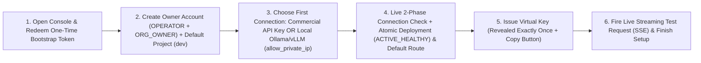
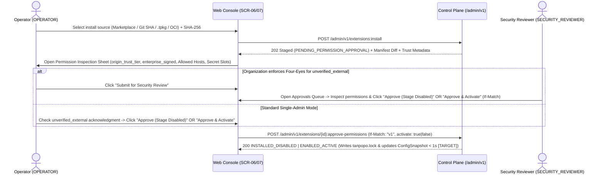

# End-to-End User Flows & Five-State UI Matrices — Tanpopo

> **Interaction Flow Specification (Phase ASTRA A06 — Reconciled in `TP-IMP-0001`)**
> - **Document ID:** `SPEC-UX-02` | **Version:** `0.2.0-tp-imp-0001` | **Last Updated:** `2026-11-14`
> - **Authored By:** Lead Product Designer & Developer Experience Lead
> - **Governance Status:** **`APPROVED (Subject to COND-PO-01..05)`** — operationalizes the 13 business workflows in [`workflows.md`](../requirements/workflows.md) into **8 core end-to-end user journeys across Web Console & `tanpopo` CLI**, complete with all **5 mandatory UI states (`Happy`, `Loading`, `Empty`, `Error`, `Offline`)** per journey and reconciled against canonical state machines `SM-01`..`SM-09` (`GAP-08`).
> - **Requirements Traceability:** `WF-01`..`WF-12`, `SM-01`..`SM-09`, `TP-FR-0101`..`1005`, `TP-NFR-0404`, `TP-NFR-0701`, `TP-NFR-1001`.

---

## Overview of the 8 Core User Journeys (`UJ-01` .. `UJ-08`)

Every user journey below strictly enforces the discipline of `frontend-ui-engineering`: **no workflow is specified solely as a Happy Path**. Each journey explicitly defines UI rendering and system feedback during asynchronous or streaming execution (`Loading`), zero-data initial or filtered states (`Empty`), contract/validation/concurrency failures (`Error`), and browser disconnection or isolated intranet operation (`Offline / Air-Gapped`). All numerical latency/duration thresholds below remain **`TARGET / UNVERIFIED`** until empirically measured (`COND-PO-01`).

---

## `UJ-01`: Zero-to-First-Successful-Request (`TTFGR < 3 Minutes` [`TARGET / UNVERIFIED`] — `WF-01`, `WF-02`)

- **Actor:** `Personal Admin` (`OPERATOR + ORG_OWNER`) or `OPERATOR` booting Tanpopo for the first time.
- **Objective:** Progress from an unconfigured fresh `tanpopo serve` process to the first successful inference request through the Unified API in **under `180 seconds` (`TARGET / UNVERIFIED`)** without consulting multi-page external setup guides.



| UI State | Concrete Interface Behavior & System Feedback |
|---|---|
| **`Happy`** | Step 1 verifies the `Bootstrap Token` (printed to `tanpopo` startup logs) and permanently invalidates it (`410 bootstrap_already_completed` on replay) upon creating the `Argon2id` owner password (`OPERATOR + ORG_OWNER`). Step 3 offers 2 clear fast paths: (a) paste an official commercial API Key (`OpenAI`/`Anthropic`/`Gemini`/`OpenAI-Compatible`) or (b) connect a local `Ollama`/`vLLM` model server with an explicit `Allow Private/Loopback Upstream` (`allow_private_ip = TRUE`) consent checkbox (`CR-10`), atomically provisioning a `Model Deployment (ACTIVE_HEALTHY)` and `Default Route`. Step 5 opens a modal dialog revealing `vk_tp_dev_...` **strictly once** alongside pre-populated `curl` / Python SDK snippets so the user can click **`"Send Test Request"`** inline, receiving live SSE token chunks plus settled `micro-USD` cost and `x-tanpopo-request-id`. |
| **`Loading`** | The `Vertical Wizard` frame (`form-wizard-vertical`) keeps the left-hand progress rail stable; clicking **`"Verify & Connect"`** enters `isLoading` state (`< 2s` `TARGET / UNVERIFIED`) while broadcasting a screen-reader status update via `useAnnounce('Verifying upstream provider connection...')`; the inline test step streams incremental token deltas in real time. |
| **`Empty`** | Prior to connecting a provider at Step 3, the model preview area renders an actionable empty state: *"No models ready yet. Connect an official commercial API key or point to a local Ollama/vLLM server to unlock your first request."* (Includes a secondary skip link to enter the Console directly and configure later). |
| **`Error`** | - Invalid or expired `Bootstrap Token` (`> 15 minutes`): renders a clear error banner quoting `tanpopo admin reset-bootstrap-token` (or `tanpopo admin reset-local-owner` for post-bootstrap local admin password recovery — `CR-09`).<br/>- Upstream API key rejected (`401` from vendor): preserves the typed connection name, clears the write-only secret input for re-entry, and displays the normalized error code without echoing raw secret text. |
| **`Offline`** | When `tanpopo` runs inside an isolated intranet without public Internet egress, the wizard detects cloud unreachability immediately, renders bundled local `Figtree` `.woff2` fonts with `0` external CDN requests (`UX-AC-10`), surfaces a calm informational `Banner` (*"Running in Local Network / Offline Mode"*), and promotes **Local Model (`Ollama` / `vLLM` / `OpenAI-Compatible LAN Endpoint`)** to the primary selection slot without hanging on external timeouts. |

---

## `UJ-02`: External Provider Plugin Installation & Explicit Permission Inspection (`WF-04`, `SM-01`)

- **Actor:** `OPERATOR` (stages installation) + `SECURITY_REVIEWER` (when organizational `Four-Eyes` governance is enabled).
- **Objective:** Install an external `Provider Adapter` package (from Marketplace, pinned 40-char Git commit SHA, `.tpkg` archive, or internal OCI registry) **without recompiling Tanpopo Core**, while mandating full inspection of publisher identity, `origin_trust_tier`, `enterprise_signed` status, and requested permissions prior to activation.



| UI State | Concrete Interface Behavior & System Feedback |
|---|---|
| **`Happy`** | The package is verified in `VERIFYING` against its `SHA-256` digest and signature, then staged in `PENDING_PERMISSION_APPROVAL` inside the mandatory **`Permission Inspection Sheet`** displaying: (1) `Token` indicators for public `origin_trust_tier` (`official`, `verified`, `unverified_external`), orthogonal `enterprise_signed` verification status, and execution tier, (2) exact outbound domains (`network.allowed_hosts`), (3) named secret slots injected via `BlindHostCredentialBroker`, and (4) CPU/memory sandbox ceilings. Approving permissions transitions cleanly to either **`INSTALLED_DISABLED`** (staged without traffic) or **`ENABLED_ACTIVE`** (`SM-01`) hot without restarting Core. |
| **`Loading`** | Displays granular verification milestones: `Downloading bundle` → `Verifying SHA-256 & Cosign/Enterprise signature` → `Validating contract compatibility` → `Extracting permission manifest`. |
| **`Empty`** | When `Installed Plugins` contains only the **5 bundled `v0.1` Official Reference Adapters** (`OpenAI`, `Anthropic`, `Gemini`, `OpenAI-Compatible`, `Ollama`), the view cleanly separates *"Bundled Official Adapters"* from an actionable callout guiding operators to *"Install additional Providers or Guardrails from Marketplace, Git SHA, or `.tpkg` archives"*. |
| **`Error`** | - `SHA-256` digest mismatch or incompatible `contract_version`: halts immediately in `REJECTED_INVALID` comparing the running Core version against the manifest's required contract range.<br/>- Manifest requests forbidden wildcard egress (`*`), `Cookie` header injection, or claims reserved namespace **`^@tanpopo(-[a-z0-9]+)?/`** without Tanpopo's offline release root signature: hard-rejects (`403 reserved_namespace_spoofing`) and records a security event in `Audit Log` (or transitions directly to `QUARANTINED` on malicious advisory match).<br/>- `409 Conflict` (`version_conflict`) from concurrent approval: reloads authoritative server state rather than overwriting. |
| **`Offline`** | When the public Marketplace index is unreachable, the `Curated Marketplace` tab displays the cached snapshot stamped with *"Offline catalog last synced: ..."* and foregrounds the 2 air-gapped installation paths: **Upload signed `.tpkg` archive** (or `.tpbundle` via `tanpopo bundle import` at `v1.0`) or **Pull from internal Private OCI Registry**. |

---

## `UJ-03`: Legitimate `Authorized OAuth 2.1` Grant & Expiry Re-Authentication (`WF-05`, `SM-02`, `SM-03`)

- **Actor:** `ORG_OWNER` or `TEAM_ADMIN`.
- **Objective:** Establish a `Provider Connection` via `OAuth 2.1 Authorization Code + PKCE (S256)` or `Device Authorization Flow` for platforms that officially sanction programmatic OAuth gateways (e.g., Google Cloud Vertex AI or enterprise internal AI SSO gateways), strictly forbidding browser session cookie pasting or repurposing consumer subscriptions into shared API proxies (`DEC-004`).

| UI State | Concrete Interface Behavior & System Feedback |
|---|---|
| **`Happy`** | The administrator selects a `Provider Adapter` declaring `auth_methods: ["oauth2_pkce"]`, picks least-privilege `scopes`, and clicks **`"Authorize with Provider"`**. The Control Plane mints a CSRF `state` nonce + PKCE `code_verifier` (`oauth_authorization_sessions`) and redirects to the vendor's official authorization server. Upon returning to `/admin/v1/oauth/callback`, Tanpopo seals the `access_token`/`refresh_token` pair directly into the write-only vault, returning to the browser only `ACTIVE` (`SM-02`) / `TOKEN_VALID` (`SM-03`) posture, principal identifier, granted `scopes`, and token expiry metadata. |
| **`Loading`** | While awaiting OAuth callback or polling during `Device Code Flow` on a headless server, the UI renders the short verification code with a live expiry countdown and an always-enabled **`"Cancel Authorization"`** button (`AUTHORIZING -> UNBOUND` or `REVOKED`). |
| **`Empty`** | If the selected `Adapter` **does not support** sanctioned OAuth (e.g., the vendor authorizes gateway access solely via pay-per-use Commercial API Keys), OAuth controls remain **completely hidden or disabled with an honest explanation**: *"This provider authorizes gateway access exclusively via Commercial API Keys; OAuth proxy flows are not supported."* |
| **`Error`** | - User denial (`access_denied`), CSRF `state` mismatch, or missing mandatory `scope` in the returned token: aborts the authorization cleanly (`UNBOUND`) with zero partial secret persistence.<br/>- Upstream revocation of `refresh_token` during production operation (`SM-02` → `AUTH_EXPIRED_REAUTH_REQUIRED`, `SM-03` → `REAUTH_REQUIRED`): surfaces a warning `Banner` with a one-click **`"Re-authorize Connection"`** button while multi-target routes automatically fail over traffic to `ACTIVE_HEALTHY` backup deployments. |
| **`Offline`** | If the administrator's browser has Internet access while `tanpopo` runs inside a restricted subnet unable to reach the vendor's `token_endpoint`, preflight connectivity validation reports `Egress unreachable to token_endpoint` immediately before opening a doomed login redirect. |

---

## `UJ-04`: Model Catalog Discovery & Capability Assurance Comparison (`FT-03`, `SPEC-EXT-02`)

- **Actor:** `DEVELOPER`, `TEAM_ADMIN`, `FINOPS_VIEWER`.
- **Objective:** Quickly discover which `Logical Models` and `Model Deployments` are available in the active `Environment`, filtering accurately by capability (`vision`, `tool_calling`, `strict_json_schema`, `reasoning`, `rerank`), data residency (`EU`, `US`, `ON_PREM`), `nano-USD`/`micro-USD` pricing, and empirical assurance tier.

| UI State | Concrete Interface Behavior & System Feedback |
|---|---|
| **`Happy`** | `/models` (scaffolded from `table-filter`) renders dense tabular rows (`Table`) showing `Model Slug`, `ACTIVE_HEALTHY` `Deployment` count, capability tags, assurance level (`Token` with distinct icons for `VERIFIED` / `TESTED` / `DECLARED`), data regions, and input/output rates per `1M tokens`. Selecting a row opens `LayoutPanel` comparing parameters supported across the **Unified API** versus vendor-specific features requiring **Native Passthrough** (`/native/...`) or marked **Unsupported**. |
| **`Loading`** | Preserves table column headers and filter controls intact while rendering `Table skeleton rows` with zero layout shift (`CLS = 0`). |
| **`Empty`** | - Zero models bound in the `Environment`: guides `TEAM_ADMIN` to attach a `Model Deployment` from an `ACTIVE` `Provider Connection`.<br/>- Over-constrained filter combination (e.g., `ON_PREM` + `audio_input` yielding 0 matches): displays **`"Clear active filters"`** and highlights which filter facet eliminated remaining candidates. |
| **`Error`** | Whenever a `Model Deployment` enters `THROTTLED_COOLDOWN`, `CIRCUIT_OPEN_UNHEALTHY`, or `HALF_OPEN_PROBING` (`SM-04`), its row surfaces the exact upstream health transition inline (e.g., `CIRCUIT_OPEN_UNHEALTHY — transitioning to HALF_OPEN_PROBING in 24s`) so engineers never discover outages blindly in production. |
| **`Offline`** | Operates `100%` from the self-hosted instance's in-memory `ConfigSnapshot` without fetching pricing tables or model catalogs from any external cloud service. |

---

## `UJ-05`: Capability-Aware Route Creation & `Route Explain` Simulation (`WF-07`, `SPEC-CORE-01`)

- **Actor:** `TEAM_ADMIN`, `ORG_OWNER`, `DEVELOPER` (dry-run simulation).
- **Objective:** Author a `Route` (e.g., `prod-assistant-default`) composing multiple fallback `Model Deployments` under a routing strategy (`PRIORITY_FAILOVER`, `WEIGHTED`, `LOWEST_COST`), enforce `Fail-Closed` data residency, and dry-run routing decisions (`Dry-Run Route Explain`) before exposing live traffic.

| UI State | Concrete Interface Behavior & System Feedback |
|---|---|
| **`Happy`** | Two-column workspace (`form-two-column`): the left column configures route slug, minimum required capabilities, data residency constraints (e.g., `EU Only — Fail Closed`), and ordered `Deployments`; the right column hosts a sticky **Live `Route Explain` Simulator** accepting synthetic request traits (`vision: true, tool_calling: true, region: EU`) and rendering the exact candidate decision tree showing why Target #1 (`ACTIVE_HEALTHY`) won and why Target #2 was eliminated (e.g., *"Eliminated: Region US violates EU residency policy"*). Saving with `If-Match` propagates to the hot router within `< 1s` (`TARGET / UNVERIFIED`). |
| **`Loading`** | Invoking `POST /admin/v1/routes:explain` renders a brief computation indicator (`< 50 ms` `TARGET / UNVERIFIED`, `0` outbound provider network calls). |
| **`Empty`** | When authoring a brand-new route prior to selecting targets, the candidate picker automatically suggests `Model Deployments` in the active `Environment` matching the project's residency posture. |
| **`Error`** | - Rejects any attempt to relax an inherited `Organization` residency or trust policy with `422 policy_relaxation_forbidden`, and warns at configuration time if all selected deployments violate parent constraints (which would fail at runtime with `503 no_compliant_deployment_available`).<br/>- Hard-locks mid-stream failover (`Fallback after partial stream` remains permanently disabled per `TP-BR-0503` with an explanatory tooltip detailing corrupted-stream prevention). |
| **`Offline`** | Both the route builder and dry-run `Route Explain` engine execute purely against in-memory Control Plane metadata with zero external network dependency. |

---

## `UJ-06`: Per-Virtual-Key MCP Tool Scoping & Human-in-the-Loop Approval for `destructive` Calls (`WF-09`, `SM-06`, `CR-08`, `COND-PO-04`)

- **Actor:** `TEAM_ADMIN` (scopes tools), `MCP Client / Agent` (invokes tool over `MCP Specification 2025-03-26`), `SECURITY_REVIEWER` / `ORG_OWNER` (approves sensitive execution).
- **Objective:** Ensure each `Virtual Key` sees and invokes strictly its allowlisted subset of `schema_hash`-pinned `MCP Tools` over **`MCP Specification 2025-03-26 (Streamable HTTP)`** (empirically verified via `CT-36` per `COND-PO-04`), while intercepting every `destructive` tool invocation in `SM-06` (`PENDING -> APPROVED -> CONSUMED | REJECTED | EXPIRED`) until an authorized reviewer approves the exact 5-tuple JCS parameter digest (`CR-08`).

```mermaid
sequenceDiagram
    actor Agent as MCP Client / Agent (Virtual Key)
    participant Hub as Tanpopo MCP Plane (/mcp — 2025-03-26)
    participant Queue as Approval Queue (SCR-14)
    actor Rev as Security Reviewer (SECURITY_REVIEWER)

    Agent->>Hub: POST /mcp (tools/call: prod_db__delete_index, arguments={index:"logs-2025"})
    Hub->>Hub: Verify Per-Key ACL + JCS schema_hash + Risk = DESTRUCTIVE
    Hub->>Queue: Create ApprovalRequest in state PENDING (5-tuple JCS sha256, expires_in=900s) + Emit Alert/Webhook
    Hub-->>Agent: HTTP 200 MCP JSON-RPC Result (isError: true, approval_request_id, resume via tanpopo__check_approval_and_resume)
    Rev->>Queue: Inspect formatted JSON arguments & Click "Approve Exact Execution"
    Queue->>Hub: Transition SM-06 state: PENDING -> APPROVED (bound to 5-tuple JCS sha256; self-approval blocked)
    Agent->>Hub: Call tanpopo__check_approval_and_resume (or replay with _meta.tanpopoApprovalToken & identical args)
    Hub->>Hub: Atomically transition SM-06 state: APPROVED -> CONSUMED
    Hub-->>Agent: HTTP 200 Execute downstream strictly once & Append immutable AuditEvent
```

| UI State | Concrete Interface Behavior & System Feedback |
|---|---|
| **`Happy`** | On the `Virtual Key` form, administrators select individual `<server_slug>__<tool_name>` grants granularly (`allowed_mcp_tools_json` defaults to `[]`). When a `destructive` call arrives over `MCP 2025-03-26` Streamable HTTP, `Security & Approvals` on `SideNav` increments its numeric `Badge` count; `SECURITY_REVIEWER` opens the inspection drawer displaying caller identity, target tool, upstream server, formatted JSON arguments, and expiry countdown. Approving transitions `PENDING -> APPROVED`, and the agent's resumption call atomically transitions `APPROVED -> CONSUMED` to execute **strictly 1 call** matching that exact 5-tuple JCS hash without requiring non-standard HTTP `202` headers (`CR-08`). |
| **`Loading`** | The approval queue streams live state updates (`PENDING`, `APPROVED`, `CONSUMED`, `REJECTED`, `EXPIRED`); clicking approve immediately locks the action button to prevent double-submission. |
| **`Empty`** | With zero `PENDING` approvals, the queue renders a calm zero-inbox posture: *"No sensitive tool executions awaiting approval"* with a link to review historical `CONSUMED` / `REJECTED` / `EXPIRED` decisions in `Audit Log`. |
| **`Error`** | - Upstream MCP server silently alters a tool's description or input schema (*MCP Rug-Pull*): Tanpopo automatically blocks calls (`403 schema_hash_drift_blocked`) and flags `/mcp/tools` with a drift alert requiring administrator review of the old-vs-new schema `diff` before re-pinning.<br/>- Agent attempts to redeem an `APPROVED` request with mutated arguments, replays an already-`CONSUMED` or `EXPIRED` request, or attempts self-approval: hard-rejected (`403 parameter_hash_mismatch` / `403 self_approval_forbidden`).<br/>- `mutating`/`destructive` tool execution times out post-dispatch: returns `ambiguous_side_effect_timeout` with zero automatic retries (`TP-BR-0603`). |
| **`Offline`** | If the `SECURITY_REVIEWER`'s browser loses connectivity to the Control Plane mid-click, the UI surfaces connection loss immediately, **never renders a fake optimistic approval**, and requires re-fetching authoritative `SM-06` server state upon reconnection. |

---

## `UJ-07`: Plugin Upgrade, Permission-Escalation Blocking & Emergency Rollback (`WF-11`, `SM-01`, `SM-08`)

- **Actor:** `OPERATOR` (plus `SECURITY_REVIEWER` when permissions expand).
- **Objective:** Upgrade a live `Extension` without dropping active inference streams, **block silent permission expansion on upgrade (`Permission Escalation`)**, and support `< 5 second` (`TARGET / UNVERIFIED`) rollback (`ROLLED_BACK`) to `previous_pinned_version_id`.

| UI State | Concrete Interface Behavior & System Feedback |
|---|---|
| **`Happy`** | - **Non-escalating upgrade (identical or narrower permissions):** Stages the new `.tpkg` archive, passes contract validation, transitions through `DRAINING` (`SM-01`), updates `tanpopo.lock` (retaining `previous_pinned_version_id` in local cache), and atomically flips `ConfigSnapshot` to `ENABLED_ACTIVE` while allowing in-flight streams on the old version to complete.<br/>- **Rollback:** Clicking **`"Rollback to Previous Pin (`v1.1.0`)"`** → confirming inside `AlertDialog` → transitions `ENABLED_ACTIVE` / `DRAINING` → `ROLLED_BACK` → `ENABLED_ACTIVE` across active nodes within `< 5 seconds` (`TARGET / UNVERIFIED`). |
| **`Loading`** | Displays explicit `SM-01` transition phases inline on the plugin row: `VERIFYING v1.2.0` → `DRAINING active streams on v1.1.0 (12 remaining)` → `ENABLED_ACTIVE on v1.2.0`. |
| **`Empty`** | If an extension sits on its initial installation pin (`previous_pinned_version_id IS NULL`), the `Rollback` button is disabled with an explanatory tooltip: *"No previous pinned version exists; use Disable (`INSTALLED_DISABLED`) or Quarantine (`QUARANTINED`) for emergency cutoff."* |
| **`Error`** | - **Permission Escalation Intercepted (`TP-BR-0403`):** Whenever `v1.2.0` requests an additional outbound domain or secret slot beyond `v1.1.0`, Tanpopo **refuses automatic activation**, parks the upgrade in `UPDATING_PENDING_RECONSENT`, keeps `v1.1.0` serving production safely, and prompts the administrator/reviewer to inspect the **Side-by-Side Permission Diff** dialog.<br/>- **Core Upgrade Contract Mismatch (`SM-08`):** If a Core upgrade preflight detects an incompatible active extension, `tanpopo` halts in `BLOCKED_INCOMPATIBLE` and allows a clean operator exit to `ABORTED_SAFE`. |
| **`Offline`** | Inside air-gapped environments, upgrades resolve directly against locally staged `.tpkg` / `.tpbundle` artifacts and verify against `tanpopo.lock` with zero Internet calls. |

---

## `UJ-08`: Tracing & Diagnosing Failed / Slow / Blocked Requests (`WF-06`, `OPS-07`, `SPEC-CORE-02`)

- **Actor:** `DEVELOPER`, `TEAM_ADMIN`, `FINOPS_VIEWER`, `SECURITY_REVIEWER`, `OPERATOR`.
- **Objective:** Whenever a client receives an error (`400`, `403`, `422`, `429`, `502`, `503`, or `mid_stream_abort`) carrying `x-tanpopo-request-id`, pasting that `request_id` into the Console pinpoints the exact hot-path stage where execution stopped and surfaces immediate remediation without exposing secrets or private prompt payloads.

| UI State | Concrete Interface Behavior & System Feedback |
|---|---|
| **`Happy`** | Pressing `Ctrl+K` and pasting `req_01j...` opens the **Request Waterfall Inspector** on `/observability/traces`, rendering per-stage spans (`Auth` → `Rate Limit` → `Budget Hold` → `Policy` → `Route Match` → `Attempt #1 Upstream 429` → `Pre-Stream Failover Attempt #2` → `TTFT` → `Budget Settlement`), cost accuracy (`EXACT` / `ESTIMATED` / `UNMETERED_FLAGGED`), normalized `CanonicalError` code, concrete remediation steps, and **`"Simulate in Route Explain"`** to replay routing metadata safely. |
| **`Loading`** | If a request finished a few hundred milliseconds ago and `AsyncTraceFlusher` is still committing the batch to storage, the UI displays *"Syncing newly completed trace record (auto-retrying in 1s)..."* rather than flashing a premature not-found error. |
| **`Empty`** | In a newly created environment with zero recorded traffic, the traces view offers quickstart actions to open `Playground` or copy an SDK snippet to send a first request. |
| **`Error`** | - If a `DEVELOPER` pastes a `request_id` belonging to another `Project` or `Organization` outside their RBAC scope: returns a uniform `404 resource_not_found` (*"Trace ID not found within authorized scope"* — `TP-BR-0101`, preventing cross-tenant enumeration).<br/>- Visually distinguishes **Successful Pre-Stream Failover** from **Mid-Stream Abort (`mid_stream_abort`)**, explaining why Tanpopo never splices output from a second upstream model once initial stream chunks have been emitted to the client. |
| **`Offline`** | Queries local `SQLite WAL` / `PostgreSQL` storage directly on the self-hosted instance; even if an external OTel collector (Grafana/Datadog) is unreachable, operators retain full visibility into locally persisted metadata traces alongside a `Banner` indicating `Fail-Open` OTLP export buffering. |
